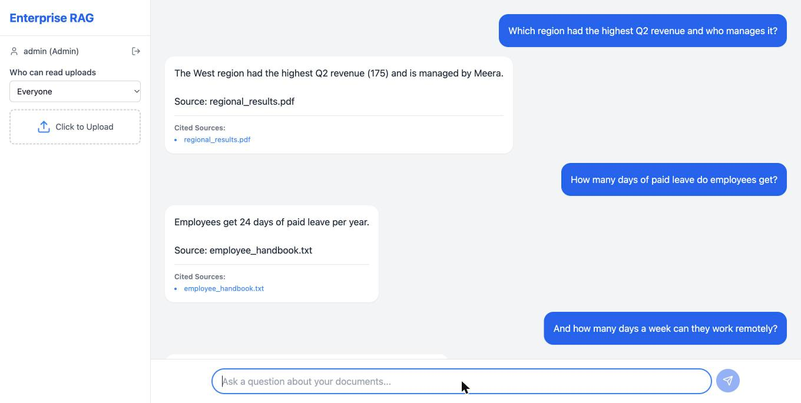
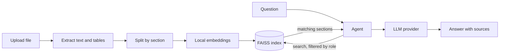
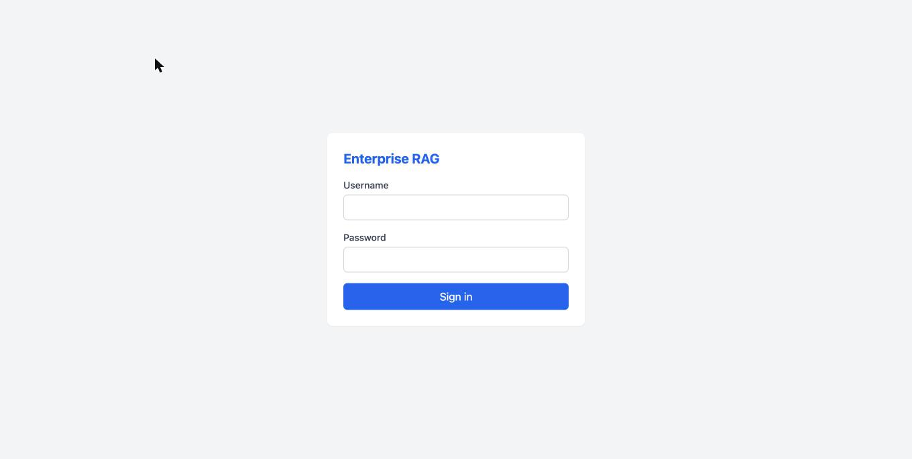

# Enterprise Knowledge Retrieval System

A role-aware document assistant. Upload PDF, DOCX or TXT files, ask questions in plain English, and get answers grounded in those documents with the source files cited.



## Features

- **Answers grounded in your documents**: an agent searches the knowledge base, can search several times for multi-part questions, and says so when the answer isn't there.
- **Structure-aware ingestion**: documents are split by section and every piece keeps its heading. PDF tables keep their rows and columns, including tables that continue across pages.
- **Role-based access**: users log in, and the server decides which documents each role can read.
- **Follow-up questions**: recent messages are used to understand the conversation.
- **Choice of LLM provider**: Groq, OpenAI or xAI, selected by whichever API key is configured.
- **Hard spending limit**: each call's worst-case cost is reserved before it is sent, and calls that could pass the limit are refused.
- **Answer cache**: repeated standalone questions are answered instantly, and any upload clears the cache.

## How it works



## Tech stack

| Layer | Technology |
|---|---|
| API | Python 3.12, FastAPI |
| Agent | LangChain |
| Vector search | FAISS with local `BAAI/bge-small-en-v1.5` embeddings |
| PDF parsing | pdfplumber |
| Answers | Groq, OpenAI or xAI |
| Frontend | React, Vite, Tailwind CSS |
| Packaging | Docker Compose |

## Getting started

You need Python 3.12 and [uv](https://docs.astral.sh/uv/), Node.js 20.19 or later, and an API key from one of the supported providers.

**1. Configure**

```bash
cp .env.example .env
```

In `.env`, set at least one API key, then add your login accounts and a signing secret:

```
OPENAI_API_KEY=your-key
AUTH_USERS=alice:choose-a-password:general,hana:choose-a-password:HR,root:choose-a-password:Admin
JWT_SECRET=output-of-openssl-rand-hex-32
```

**2. Start the backend**

```bash
cd backend
uv venv --python 3.12 .venv
uv pip install --python .venv/bin/python -r requirements-dev.txt
.venv/bin/uvicorn main:app --port 8000
```

The embedding model is downloaded on first start.

**3. Start the frontend**

```bash
cd frontend
npm install
npm run dev
```

Open http://localhost:5173 and sign in.

To run both with Docker instead: `docker compose up --build`.



## Configuration

| Variable | Purpose | Default |
|---|---|---|
| `GROQ_API_KEY`, `OPENAI_API_KEY`, `XAI_API_KEY` | Provider keys. If several are set, the order is Groq, OpenAI, xAI | empty |
| `LLM_PROVIDER` | Force a provider: `groq`, `openai` or `xai` | automatic |
| `GROQ_MODEL`, `OPENAI_MODEL`, `XAI_MODEL` | Model per provider | see `.env.example` |
| `LLM_BUDGET_USD` | Total AI spending limit | `0.50` |
| `AUTH_USERS` | `username:password:role`, comma separated. Passwords can't contain commas | empty |
| `JWT_SECRET` | Signs login tokens | random at each start |
| `MAX_UPLOAD_MB` | Largest accepted upload | `25` |
| `CORS_ORIGINS` | Allowed frontend origins | `http://localhost:5173` |
| `ENABLE_API_DOCS` | Serve interactive docs at `/docs` | `false` |

## Roles

| Role | Can read | Can publish to |
|---|---|---|
| `general` | Documents for everyone | Everyone |
| `HR` | Documents for everyone and HR | Everyone, HR |
| `Admin` | All documents | Any role |

## API

| Method | Path | Access | Purpose |
|---|---|---|---|
| `POST` | `/api/auth/login` | Public | Get a login token |
| `POST` | `/api/ingest` | Logged in | Upload and index a document |
| `POST` | `/api/query` | Logged in | Ask a question |
| `GET` | `/api/usage` | Admin | Provider and spend so far |
| `GET` | `/api/health` | Public | Health check |

## Security

- Passwords are checked in constant time, and repeated failed logins are blocked for a few minutes.
- A user's role comes from a signed token, never from the request.
- Uploads are restricted by type and size, and file names can't escape the upload folder.
- API keys and uploaded documents are excluded from version control.

Accounts are defined in `.env`, which suits a single team or a demo. Connect a real identity provider and put the API behind HTTPS before exposing it to the internet.

## Tests

```bash
cd backend
.venv/bin/python -m pytest
```

The suite covers access control, token forgery, uploads, ingestion, tables, retrieval, the agent flow and the spending limit. It needs no API key.

## Known limitations

- Scanned PDFs are rejected because OCR is not included.
- Section detection relies on ALL-CAPS or numbered headings.
- Tables are preserved for PDFs only. DOCX tables are read as plain text.
- FAISS runs in a single backend process, so scaling out would need a vector database server.

## License

No license has been chosen yet, so all rights are reserved by default.
